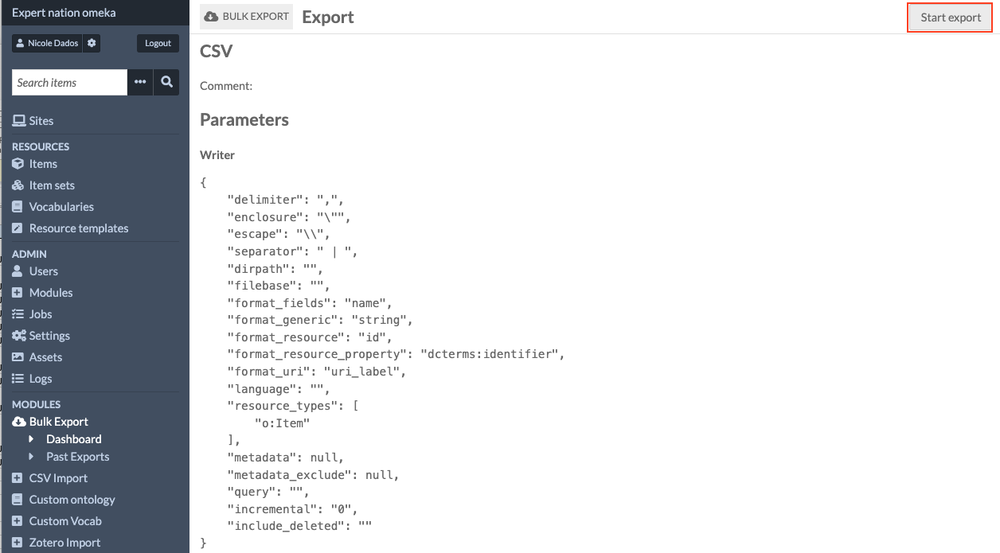

# Exporting records

Records can be exported from Expert Nation Omeka using the **Bulk Export** module. You need to be logged in to the admin side of the site to use it.

An export creates a file (for example a CSV spreadsheet) containing the metadata for the records you choose. This is useful for analysing the data in Excel or another tool, sharing a snapshot of the collection, or keeping your own working copy.

## Step 1: Open the Bulk Export dashboard

1. In the left-hand menu, scroll down to **Modules** and click **Bulk Export**, then **Dashboard**.
2. Under **Available exporters**, choose the file format you want. The options are:
   - **CSV**: opens in Excel, Google Sheets and most other tools. This is the best choice for most people.
   - **OpenDocument spreadsheet (ods)**: for LibreOffice Calc.
   - **OpenDocument text (odt)**: a text document rather than a spreadsheet.
   - **Text**: plain text.
   - **TSV (tab-separated values)**: like CSV, but the columns are separated by tabs instead of commas.
3. Click the name of the format, for example **CSV**.

The **Last exports** table at the bottom of the dashboard lists recent exports, who ran them, and their status. You'll come back here to download your file once it's ready (see Step 4).

## Step 2: Check the export settings

The next screen shows the settings for the format you chose. **The defaults work well for most exports**, so you can usually leave them as they are. The settings you are most likely to want to change are:

- **Comment**: an optional note to remind yourself what the export was for (for example, "All persons, October 2026"). It appears in the Last exports list.
- **Metadata names or headers**: controls the column headings in your file.
  - **Rdf names** (default) uses the technical property names, such as `dcterms:title`. Choose this if the file might be imported back into Omeka later.
  - **Labels** uses the readable field names, such as "Title". This is easier to read if you're just working with the data in a spreadsheet.
- **Format of linked resources**: controls how links to other records (such as a related person or a place) appear.
  - **Id** (default) shows the record's Omeka ID number.
  - **Title** shows the name of the linked record, which is easier to read.
  - **Omeka url and title** shows both.
- **Multi-value separator**: when a field has more than one value, the values are joined with this character (`|` by default) in a single cell.

Leave **Use a background job** ticked. Large exports can take a few minutes, and this lets the export run without you having to keep the page open.

There are further settings lower down the form. Leave these as they are unless you need to change them.

When you're ready, click **Continue** at the top right of the page.

## Step 3: Start the export

The confirmation screen summarises the settings you chose, under **Parameters**. You don't need to read or change anything here. If something looks wrong, use your browser's back button to return to the settings.

Click **Start export** at the top right of the page.

## Step 4: Download your file

1. Go back to **Bulk Export** > **Dashboard**.
2. Find your export in the **Last exports** table. While it is running, its status shows **in_progress**.
3. When the status changes to **Completed**, click the **download icon** (the cloud with an arrow) beside it to save the file to your computer.

If the status doesn't change after a few minutes, refresh the page.

Exported files are saved on the Expert Nation Omeka server and are listed under **Bulk Export** > **Past Exports**. If you no longer need an export, you can remove it using the bin icon.

---
